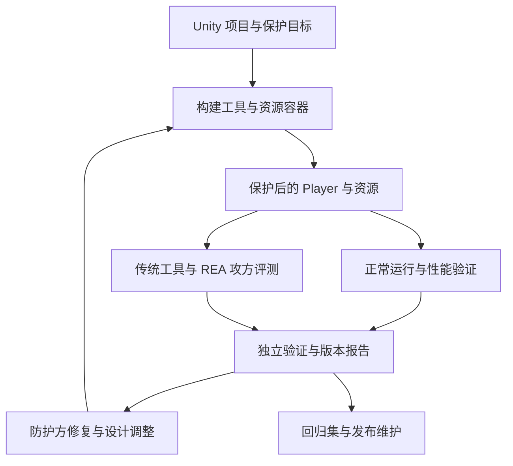

# kingsSafe 技术方案

技术路线以构建期准备与运行时执行配套：v0.1 对清单内资源生成受保护容器，由加载适配器校验、解密并交给 Unity；v0.2 对明确选定的关键数据进行受限表示变换与读写校验。逻辑混淆作为第三项核心功能，独立保护关键实现，并与资产加固和内存保护共同验证。

下述为产品候选设计。2026 年 10 月 30 日已完成一个 Mac Mono 隔离样本的构建自动接入探针，见[可行性与实测](build-hardening-feasibility.md)。接口存在、算法成熟或样本能启动，都不表示已经实现完整保护；该探针不是这里描述的正式分块资源容器、抗重放内存方案或完整逻辑混淆器。

## 自动接入契约

产品形态为仅引入 Unity 插件，继续原 Build。Editor 自动注册扩展、分析兼容条件并生成默认保护配置；资源适配、运行组件与程序集变换由插件在构建副本中完成。不能要求团队手动替换资源加载、字段类型、场景组件或构建入口。内部机制实验可以手工接通，但不计为产品接入完成。

默认保护范围按版本与平台明确，不能处理的路径进入覆盖报告。必要覆盖失败则构建失败，不以静默跳过或要求业务改造来维持成功状态。

## 技术分层

| 层 | 构建与打包工作 | 游戏运行期工作 |
| --- | --- | --- |
| 资源核心 | 选择 Bundle、加密、认证和版本绑定，生成清单 | 校验、按需解密、加载与生命周期管理 |
| 数据核心 | 分析选定字段及访问点，生成受保护存储和访问适配 | 编码存储、读写校验、篡改信号与处置接口 |
| 逻辑混淆核心 | 对选定核心算法和业务路径做受限逻辑变换，保留诊断资料 | 按配置执行变换后逻辑，保持原有语义 |
| 验证体系 | 生成基线、保护构建和固定实验配置 | 独立测试与攻防环境，不承担业务安全判定 |

REA 与传统逆向工具运行在攻方实验环境，不进入 Player。正常 Player 会包含必要的 kingsSafe Runtime，Editor 构建代码与私有映射不进入 Player。

## 资源范围与接入

首版从本地 AssetBundle 开始，不自动加密全部 Unity 文件。原始资产与原 Bundle 内部保存，保护工具只生成独立发行副本，记录目标资源、原始摘要、容器版本和加载入口。资源内容不重新编码或降低品质。

第一步可用内部样本加载门面验证容器；产品验收必须改为由插件自动接管受支持加载路径，并研究标准 Addressables provider 自动接入，保持业务侧的资源 key 和调用语义。Unity 提供 Stream 加载及 Addressables provider 扩展接口，但需要固定版本实测，不能把资源名映射器当成完整加载实现。[U08/U09](sources.md)

原项目直接调用 LoadFromFile、使用 Resources、内置场景或第三方资源系统时，所需适配必须由插件自动完成；不能自动接管的路径列为该版本未支持，不得被加密或计入覆盖率。全局 API Hook 与修改 UnityPlayer 不作为默认接入方式。

## 资源容器候选

采用成熟的认证加密机制，按可随机读取的独立块组织容器。AES-GCM 是候选配置，具体密码库需通过 Unity IL2CPP 和目标机器验证；桌面 .NET 存在同名 API 不代表 Unity 后端可用。[C01](sources.md)

容器设计先形成版本化格式，包含有限长的头、原始长度、块大小、块索引、内容与版本标识、密钥标识、密文和认证标签。解析器先校验长度和范围，避免未认证索引造成越界、巨大分配或错误寻址。

每块在明文交给 Unity 前完成认证；认证绑定容器身份、版本、块编号和长度，检查替换、重排、截断和跨包混用。同一密钥下 nonce 必须唯一，重打包也需维护唯一性；不能为可复现构建而错误复用。公开格式和测试向量，避免自制密码算法。

整体清单与版本关系需要受认证约束。若使用发行签名，私钥在构建侧，客户端仅携带验证公钥。签名保证未被修改的验证链能够识别错误内容，不能阻止攻击者定向修补本地验证器。

## 密钥与开源边界

每个游戏、内容版本和 Bundle 隔离密钥域，避免仓库中的固定通用密钥。配置只引用密钥标识，真实密钥由构建环境提供，不能写入日志、公共报告或公开配置。

离线模式需让客户端具备解密能力，因此必须接受从代码或内存中提取解密能力的风险；代码拆分和混淆只能提高分析成本。密钥交付作为单独技术决策验证，不能因为代码不开源而假定安全。首轮可使用明确标记的研发交付方式，但通过互操作测试不等于达到发行安全要求。

联网授权可作为以后独立配置，不作为离线资源保护的默认前提。资源解密材料与签名私钥严格区分，后者无须随客户端交付。

## 加载与缓存

候选加载链为“容器解析 → 已认证块缓存 → 解密 Stream → Unity AssetBundle 加载 → 资源使用 → 卸载清理”。同一块先验证再提供数据，缓冲按上限管理。

Stream 需支持随机读取、Seek、Length、跨 Unity 线程访问和正确 EOF，生命周期覆盖 Bundle 及其资产读取。Unity 官方说明加载可能从原生线程调用读取，不能把主线程同步读取当作唯一情况。[U08](sources.md)

不把完整明文 Bundle 写入临时文件后加载。下载缓存和更新文件保持密文；明文缓冲尽量缩短生命周期，但不承诺托管堆、Unity native 内存或 GPU 中的资源副本可被完全清零。资源实际使用时可读，运行时资产提取作为独立攻方任务记录。

缓存标识绑定内容和格式版本，内存缓冲设置上限并在释放时清理。清理不能早于 Unity 最后一次访问。失败、取消、异常退出、依赖释放和重复加载都要验证；不能因为解密失败自动回退明文。

更新设计保留密文摘要、内容版本与清单匹配关系。资源版本迁移和客户端回滚需配对，旧包不得因单纯文件名相同被新清单误接受；恶意全版本回滚的更强防护需另作信任设计。首版未完成远程更新验收前不宣称支持 CDN 和完整热更新。

## 关键数据保护

首批对象为普通自有托管类中主线程访问的非序列化整数，例如样本内血量或弹药；不是整个进程内存。针对常规搜索、直接写入和冻结分别设计实验。

候选机制是将值保存为变化的内部表示与校验状态，在读取和写入时验证。不得长期保留原值明文镜像，也不能把简单编码等同于密码学保密或阻断全部修改。重放旧存储、同时修改数据与校验、冻结存储、替换读取结果和修补检查点均需列入边界实验。

首选研究构建期自动字段访问适配，保持原始业务源码和调用方式，不要求手动安全类型、属性标注或 SDK 调用。显式受保护类型仅用于内部机制对照，不能作为零业务改动产品验收样本。反射、ref/out、native interop、Burst、Jobs、跨线程、显式布局、序列化和第三方字段先排除。

字段变换前枚举全部访问点和保留依赖，变换后验证正常运算、checked/unchecked 溢出语义与访问顺序。无足够证据确认兼容时保留该字段；必选目标未保护则构建失败。原存档和网络只通过契约适配输出原语义，不改变外部格式。

篡改检测与阻断是不同能力。必须定义校验时点、错误返回或异常、业务回调和动作发生前的拒绝方式；只打印告警但作弊收益已生效，不能算阻断。不能静默返回零、自动封号或破坏存档。

进程内检查可能被同进程补丁或更高权限绕过。Windows 内存访问本身有权限边界，首版不引入驱动并承诺全权限防护。[W01](sources.md) 联网游戏可接服务端验证，但不隐式更改原协议。

## 内存窥探探测与响应

在内存保护中独立研究 G6：构建时自动带入监测组件、受支持的字段插桩与平台原生适配，研究调试状态、独立内存区域访问和完整性信号。保留异常成立时终止自身应用的路线，但不能把普通应用的可见性提升为内核可见性。

监测、读取结果、访问拒绝、非法收益和终止分别给出证据。守卫页的一次性访问异常或页面驻留变化不单独构成所有外部读取的证明。默认不安装驱动、不增常驻服务，不要求额外管理员权限。

自终止可能发生在数据已被读取之后，也可能打断原业务写入。无业务改动条件下的退出与数据安全必须单独验证；开发诊断策略自动区分，正常流程不应误终止。平台分工、候选机制和 O01 到 O09、Z01 到 Z04 的实验见[专项调研](memory-observation-research.md)。

## 逻辑混淆

保护核心业务算法、独有机制、授权判断和关键安全实现，目标分别对应函数定位、语义恢复、等价重建与行为篡改。逻辑混淆是独立核心功能，不只承担其他组件的附属保护。

名称、控制流、数据表示变换与代码虚拟化属于不同候选，先按受限白名单建立语义等价与攻击成本实验，再选择实际路线。不能以方法改名代表完整能力；任何变换仍需独立验证兼容性和性能。不以扫描工具进程名或阻断正常环境代替逻辑混淆。

Unity 程序集构建回调可作为受限插桩候选，具体时序与缓存需在固定补丁验证。[U02](sources.md) 反射、Unity 消息、序列化、事件和 Linker 保留规则仍然约束变换。[U05/U06/U07](sources.md)

## 发行与恢复

每次构建使用独立工作区，保留输入摘要、配置版本、保护对象、实际覆盖、格式、密钥标识和验证状态。构建失败不发布未保护替代包。重复回调幂等，不修改原 Assets、共享缓存或 Unity 安装。

加密和任何代码变换先于最终签名，最终摘要在签名后记录于旁路报告。私有映射、密钥和符号内部归档。关闭保护后可以恢复明确的基线构建；版本迁移同时记录容器、运行库和数据表示兼容性。

## 尚需决定的技术项

| 决策 | 依据 | 必须先完成的验证 |
| --- | --- | --- |
| 密码库与分块配置 | 认证、随机读、依赖和平台支持 | 已知向量、错误标签、IL2CPP 与性能 |
| 离线密钥交付 | 开源攻击模型、发行与轮换 | A2/A3 提取和跨游戏复用 |
| 加载入口 | 现有资源系统与接入成本 | Stream、provider、异步和卸载 |
| 字段接入方式 | 透明性、布局和语言语义 | 受限插桩与显式类型对照 |
| 篡改处置 | 不接受损坏数据、保持正常体验 | 使用前拒绝和误报测试 |
| 性能预算 | 设备、场景和用户体验 | 实验前固定，实测与预算分别报告 |

上述项目在可行性阶段形成决策记录后再实现，不把未验证候选写成既成支持。
